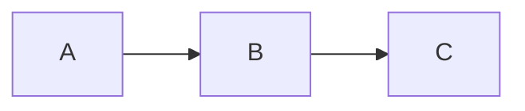

# Jekbon's Blog

个人博客 → [https://jekbon.github.io](https://jekbon.github.io)

| 组件 | 版本 | 作用 |
|---|---|---|
| Hugo extended | 0.170.1 | 静态站点生成，构建 < 1s |
| [Rusty Poison](https://github.com/RustyDaemon/rusty-poison) | 0.4.2 | 主题（dark-first，侧栏布局，锈橙强调色） |
| Tailwind CSS | 4.2.4 | 主题样式管道（Hugo `css.TailwindCSS`） |
| Pagefind | 1.5.2 | 静态全文搜索索引 |
| Mermaid | 11.15.0 | 图表（按需懒加载） |

发布链路：push 到 `main` → GitHub Actions 构建 → GitHub Pages，约 2 分钟。

## 本地环境

```bash
brew install hugo node
npm ci          # 装 Tailwind / Pagefind / Mermaid，首次或依赖变更后执行
```

Hugo 必须 **extended 版 ≥ 0.158.0**（主题用了 `css.TailwindCSS` 管道），
且版本要与 `.github/workflows/hugo.yaml` 里的 `HUGO_VERSION` 一致，
否则会出现「本地正常、线上失败」。

## 日常命令

```bash
npm run dev      # 本地预览 http://localhost:1313（草稿也渲染）
npm run build    # 生产构建 + 生成 Pagefind 索引
npm run search   # 只重建搜索索引
```

> `npm run dev` 下**站内搜索不可用**：Pagefind 的索引写在 `public/` 里，
> 而 dev 模式不落盘构建产物。要测搜索得 `npm run build && npx serve public`。

## 写一篇文章

```bash
./new-post.sh k8s-pvc-pending "PVC 一直 Pending 的排查"
npm run dev                      # 边写边看
```

front matter 字段（主题认这些）：

```yaml
---
title: "文章标题"
date: 2026-11-18T09:30:00+08:00   # 必须带时区偏移
draft: false
description: "标题下方的一句话引子"
tags: ["Kubernetes", "排障"]
series: "K8s 排障实录"             # 可选，同系列文章会互相列出
featuredImage: "/images/cover.png" # 可选，放在 static/images/
hideToc: true                      # 可选，单篇关掉右侧目录
project: false                     # true 则归入 projects 而非文章
---
```

写完把 `draft: true` 改成 `false`，然后：

```bash
git add -A && git commit -m "post: 标题" && git push
```

查看发布进度：

```bash
gh run list --limit 5
gh run watch
```

## Markdown 增强

**GitHub 风格提示块**（主题原生支持）：

```md
> [!NOTE]
> 普通说明

> [!WARNING]
> 需要注意的风险

> [!TIP]
> 更省事的做法
```

**Mermaid 图表**：

````md

````

**折叠块**（主题 shortcode）：

```md

日志内容

```

**数学公式**：`$行内$`、`$$块级$$` 已配置透传，但主题**不带 KaTeX 运行时**，
要真正渲染得自己加载 KaTeX/MathJax。

## 配色

暗色是主题默认，配色 token 在主题的 `assets/css/main.css` 的 `@theme` 块里：

| token | 默认值 | 用途 |
|---|---|---|
| `--color-bg-dark` | `#0e0f10` | 正文区背景 |
| `--color-bg-soft-dark` | `#161719` | 次级背景 |
| `--color-bg-raised-dark` | `#1c1d20` | 卡片 / 代码块 |
| `--color-panel` | `#0a0b0c` | 侧边栏（恒定深色，不随明暗切换） |
| `--color-fg-dark` | `#ececec` | 正文文字 |

改法：在站点根建 `assets/css/main.css`（同名覆盖主题文件），复制 `@theme` 块改数值。
想要更黑就把 `--color-bg-dark` 改成 `#000000`。

## 踩过的坑

**1. 首次构建报 `tailwindcss is not whitelisted`**

Hugo 默认的 `security.exec.allow` 不含 `tailwindcss`，而主题的 `css.TailwindCSS`
要执行它。必须在**项目自己的** `hugo.toml` 里放开（`[security]` 不会从主题合并），
且 `allow` 是替换而非追加，官方条目要一并写上：

```toml
[security]
  [security.exec]
    allow = ['^(dart-)?sass$', '^go$', '^git$', '^node$', '^postcss$', '^tailwindcss$']
```

**2. 直接跑 `hugo` 报找不到 tailwindcss**

`tailwindcss` 装在 `node_modules/.bin/`，该目录只在 **npm script 执行期间**才被加进 PATH。
所以构建必须走 `npm run build`，CI 里也一样，不能直接调 `hugo`。

**3. 文章「消失」——日期是未来时间**

`buildFuture` 默认 false，front matter 的 `date` 晚于当前时刻时文章会被**静默跳过**：
不报错、不告警、首页和列表都看不到。排查：

```bash
hugo list future
```

`./new-post.sh` 用当前时间生成日期就是为了避开这个。想定时发布就设 `buildFuture = true`。

**4. 首页不显示文章——缺 `front_page_content`**

```toml
[params]
  front_page_content = ["posts"]
```

漏掉不会报错，首页直接空白。

**5. 线上构建拉不到主题——submodule 用了 SSH 地址**

`.gitmodules` 里必须是 `https://`，不能是 `git@github.com:`。
Actions runner 没有你的 SSH 私钥，本地正常、线上 checkout 直接
`Permission denied (publickey)`。已写错的话：

```bash
git config -f .gitmodules submodule.themes/rusty-poison.url \
  https://github.com/RustyDaemon/rusty-poison.git
git submodule sync --recursive
```

**6. `--minify` 压坏 RSS**

`[minify] disableXML = true` 别删，否则 `/index.xml` 会坏掉。

**7. 本机有两个 node，brew 那个的 CA 库是坏的**

```
/Users/wangbin/.local/bin/node   v22.23.2   TLS 正常  ← 用这个
/opt/homebrew/bin/node           v23.11.0   对任何 HTTPS 站点都报
                                            UNABLE_TO_GET_ISSUER_CERT_LOCALLY
```

如果 `export PATH="/opt/homebrew/bin:$PATH"` 走在前面，`npm install` 会失败，
但错误信息指向 registry 证书，容易误判成镜像问题（实际 `curl` 访问同一个
registry 完全正常，因为 curl 走 macOS 钥匙串，node 走自己的 CA bundle）。

正确顺序——让 `~/.local/bin` 在前，同时保留 brew 的 hugo：

```bash
export PATH="$PWD/node_modules/.bin:$HOME/.local/bin:/opt/homebrew/bin:$PATH"
```

前面加 `node_modules/.bin` 是为了能直接跑 `hugo`（Tailwind 需要 `tailwindcss` 在 PATH）。
CI 用 `actions/setup-node` 装 Node 22，不受此影响。

**8. 本地直接 `npm run build` 后开静态服务器会白屏——`<base href>` 指向线上域**

主题在 `partials/head/meta.html:54` 输出了 `<base href="{{ .Permalink }}">`。
于是所有 root-relative 资源（`/css/...`、`/js/...`）都会拼到 base 的 origin 上。
如果你用默认的 `baseURL = "https://jekbon.github.io/"` 构建再在 localhost 打开，
浏览器会去请求**线上域名**的资源——站点没上线时 404，上线后则因跨域被 CORS 拦截，
整页变成无样式裸 HTML。

本地预览必须用本地 baseURL，一条命令搞定（含 Pagefind 索引和静态服务）：

```bash
npm run preview        # http://127.0.0.1:1313，等同线上的生产构建
```

CI 不受影响：workflow 里用 `--baseURL "${{ steps.pages.outputs.base_url }}/"`，
base 的 origin 与真实域一致。

**9. 主题自带的 JetBrains Mono 字体文件是坏的**

`themes/rusty-poison/static/fonts/JetBrainsMono-*.woff2` 的文件头是四个换行符
而不是 `wOF2`（git 仓库里就这样，非传输损坏），浏览器报
`OTS parsing error: invalid sfntVersion`。Inter 的两个文件是正常的。

已在站点 `static/fonts/` 放了一份正确的 variable 字体覆盖它
（Hugo 的站点 static 优先于主题 static），来源
`@fontsource-variable/jetbrains-mono@5.2.8`，许可证一并保留。
主题升级后若上游修好了，可以删掉本站这两份覆盖。

## 中文化

主题**没有 i18n**（无 `i18n/` 目录，多语言支持的 PR #7 还没合并），界面文字全是硬编码英文。
本站在 `layouts/` 下覆盖了 **20 个模板、59 处**文字，实现完整中文界面：

| 区域 | 覆盖后 |
|---|---|
| 侧栏 | `// 导航`、`首页`、`// 链接`、`切换主题`、`● 在线 / 构建于 / 版本 / hugo` |
| 顶栏 | `搜索文章…`（占位符与按钮） |
| 文章页 | `本页目录`、`X 分钟阅读`、`X 字`、`2006年01月02日`、`// 所属系列：`、`· 第 X / Y 篇`、`// 相关文章`、`上一篇 / 下一篇` |
| 列表页 | `// 2026` 年份分组、`项目` 徽标、taxonomy 标题（标签 / 系列 / 文章） |
| 搜索弹窗 | `搜索文章…`、`输入关键词开始搜索`、`选择 / 打开 / 关闭` |
| 404 页 | `守护进程找不到这个页面`、`返回首页 / 全部文章 / 浏览标签` |
| 无障碍 | 所有 `aria-label`、`title` 也已中文化 |

**刻意保留英文**的部分（翻译会破坏设计意图）：

- 404 页的终端仿真块 `rusty@daemon:~$ resolve /path` → `ENOENT — no such file or directory` → `suggest --next`
- 搜索弹窗的按键名 `esc`
- 侧栏署名的 `hugo` 与 `rusty-poison`（是外链）

**升级主题时注意**：这些覆盖是主题模板的整份拷贝，上游改动不会自动合并。
升级后建议 `diff -r themes/rusty-poison/layouts layouts` 比对，
或用下面的脚本重新生成覆盖（替换规则集中在一处）：见 `scripts/relocalize.py`。

taxonomy 与 section 的标题不在模板里，而是由这些文件提供：

```
content/tags/_index.md     → title: "标签"
content/series/_index.md   → title: "系列"
content/posts/_index.md    → title: "文章"
```

## 已修复的主题 bug

**中文 series 名会导致整个系列块消失**

主题用 `GetPage (print "series/" (. | urlize))` 查系列页，但 `urlize` 会把中文
转成百分号编码：

```
urlize "测试系列"  →  %E6%B5%8B%E8%AF%95%E7%B3%BB%E5%88%97
taxonomy 实际 key  →  测试系列          ← 两者不匹配
```

`GetPage` 返回 nil，而 series 块外层是 `{{ if $series }}` 硬条件，于是
「所属系列」和「第 X / Y 篇」**整块静默消失**（英文 series 名正常）。

本站已在覆盖模板里去掉 `urlize`（5 处：`index.html`、`_default/list.html`、
`post/info.html`、`post/series.html`、`post/breadcrumbs.html`），中英文 series 均已验证可用。

> 中文 **tags** 不受影响：那里 `GetPage` 失败只会拿不到 `LinkTitle` 而优雅降级，
> 标签页和链接都正常。

